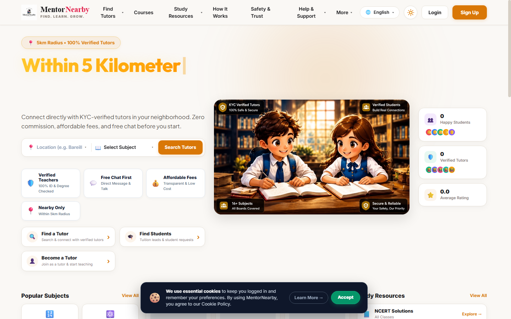
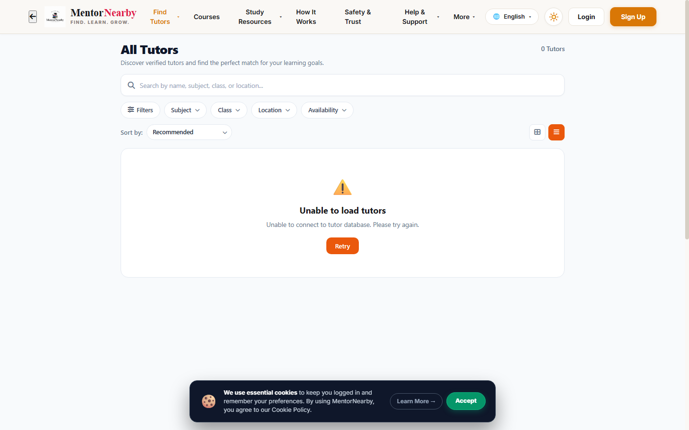
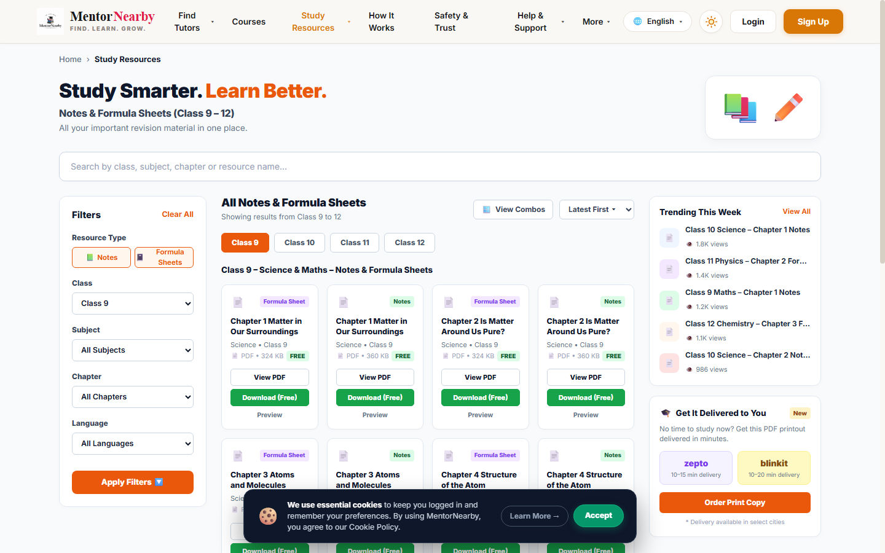
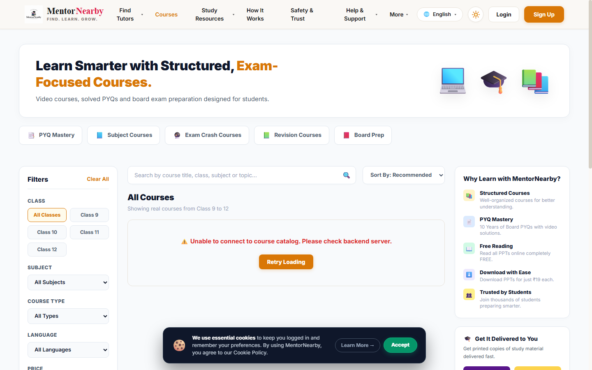
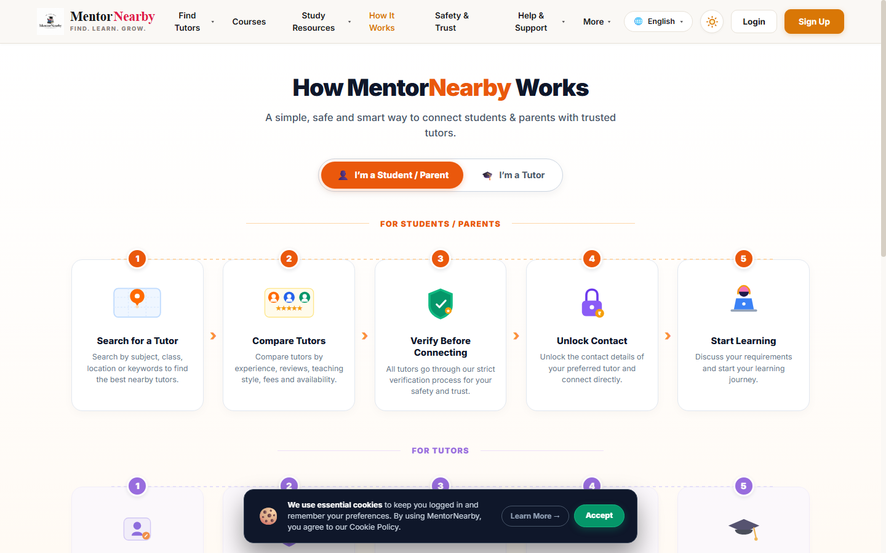
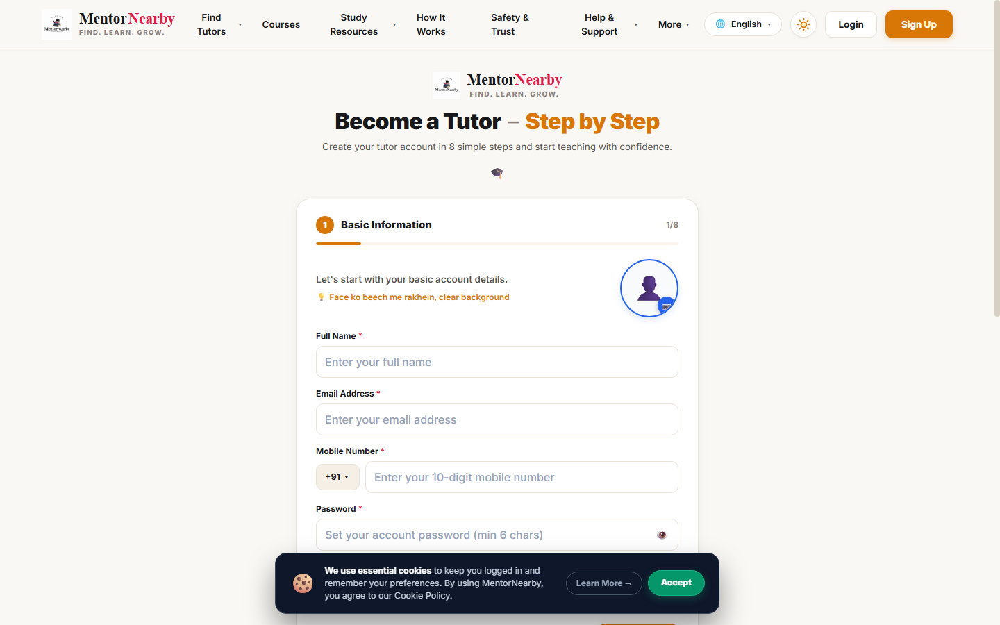
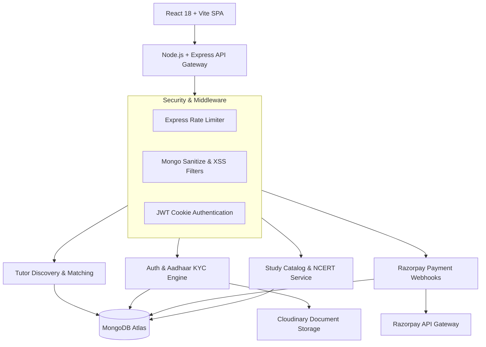

# MentorNearby — Hyperlocal Tutor & Mentorship Marketplace

<p align="center">
  <strong>Production-Ready EdTech Marketplace Connecting Students & Parents with Verified Local Tutors</strong>
</p>

<p align="center">
  
  
  
  
  
  
  
  
</p>

---

## 📌 Executive Summary

Finding qualified, trustworthy home tutors and academic mentors remains a fragmented and risky process in India. Parents struggle with unverified credentials, opaque pricing, and safety concerns, while dedicated tutors lack discovery mechanisms and secure payment rails.

**MentorNearby** (also known as *TutorNearby*) bridges this gap with an end-to-end trusted marketplace featuring **government Aadhaar KYC validation**, proximity-based tutor matching, transparent hourly pricing, verified student reviews, NCERT digital textbook libraries, and direct tutor contact unlocks powered by Razorpay.

---

## 📸 Real Application Gallery

### 1. Platform Landing & Search Portal (`/`)
*Dynamic hero discovery with grade filters, subject categories, verified badge counters, and geolocation matching.*


### 2. Hyperlocal Tutor Discovery & Advanced Filters (`/search`)
*Comprehensive directory with subject, class (CBSE/ICSE/State), fee range, rating, and radius filters.*


### 3. Digital Academic Study Resources (`/study-resources`)
*Integrated NCERT textbook reader, subject notes, chapter-wise breakdown, and downloadable reference materials.*


### 4. Structured Video Courses & Bundles (`/courses`)
*Subject mastery courses with previews, curriculum syllabus, instructor bios, and instant enrollment.*


### 5. Platform Transparency & Parent Safety (`/how-it-works`)
*Detailed onboarding guide for students and educators detailing verification and matching protocols.*


### 6. Educator Onboarding & Aadhaar Verification (`/become-a-tutor`)
*Multi-step tutor registration wizard incorporating document uploads, educational background, and ID checks.*


---

## 🚀 Key Implemented Features

### 🎓 For Students & Parents
- **Proximity Tutor Search**: Filter tutors by geographic radius, target academic board (CBSE, ICSE, State Board), competitive exams (JEE, NEET), and hourly rate.
- **Verified Educator Profiles**: Detailed profiles showcasing education degrees, teaching experience, verified ID badges, and genuine student feedback.
- **Secure Contact Unlock**: Direct phone and WhatsApp communication unlock using Razorpay integration with micro-transactions.
- **Study Hub & NCERT Reader**: Built-in digital library with full NCERT textbooks, syllabus breakdowns, and downloadable study guides.
- **Student Dashboard**: Track contacted tutors, active courses, learning materials, and post custom academic tutor requirements.

### 👨‍🏫 For Tutors & Mentors
- **Multi-Step Onboarding**: Streamlined 7-step onboarding covering personal background, subject expertise, location preferences, and KYC document uploads.
- **Aadhaar ID Validation**: Client-side and server-side checksum algorithms ensuring valid government identification.
- **Lead Management**: Receive student inquiries, respond to local tuition requests, and view profile impressions.
- **Review System**: Automated review collection from verified students to boost profile ranking.

### 🛡️ For Platform Administrators
- **Executive Admin Console**: Dedicated admin suite with audit logs, revenue metrics, and user management.
- **KYC Review Queue**: Admin verification pipeline to inspect tutor documentation and approve/reject verified badges.
- **CMS Management**: Control banners, announcements, subject categories, and footer policies without code changes.

---

## 🏗 System Architecture



---

## 💻 Tech Stack

| Domain | Technology | Purpose |
|---|---|---|
| **Frontend Framework** | React 18, Vite | Fast Single Page Application with optimized bundle splitting |
| **Styling & Icons** | Vanilla CSS, Lucide Icons | Custom design system with light/dark theme support |
| **Routing & State** | React Router v6, React Context API | Client routing and persistent auth/notification states |
| **Backend Framework** | Node.js, Express.js | Scalable REST API with security middleware and rate limiting |
| **Database** | MongoDB Atlas, Mongoose ODM | Document storage for tutors, students, reviews, and bookings |
| **File Storage** | Cloudinary API | Cloud storage for tutor certificates, avatars, and KYC IDs |
| **Payments** | Razorpay SDK | Contact unlocking and course purchase transactions |
| **Security** | bcryptjs, cookie-parser, helmet | Password hashing, secure HTTP-only cookies, security headers |

---

## ⚙️ Local Installation & Setup

### Prerequisites
- Node.js `18.x` or higher
- MongoDB instance (Local or MongoDB Atlas connection string)
- npm `9.x` or higher

### Steps

1. **Clone the repository:**
   ```bash
   git clone https://github.com/priyanshukumar09546-cpu/MentorNearby.git
   cd MentorNearby
   ```

2. **Install all dependencies:**
   ```bash
   npm run install:all
   ```

3. **Configure Environment Variables:**
   Create `.env` inside `backend/`:
   ```env
   PORT=5000
   NODE_ENV=development
   MONGO_URI=mongodb+srv://<user>:<password>@cluster0.mongodb.net/tutornearby?retryWrites=true&w=majority
   JWT_SECRET=your_jwt_secret_key_here
   JWT_EXPIRES_IN=7d
   FRONTEND_URL=http://localhost:5173
   CLOUDINARY_CLOUD_NAME=your_cloud_name
   CLOUDINARY_API_KEY=your_api_key
   CLOUDINARY_API_SECRET=your_api_secret
   RAZORPAY_KEY_ID=your_razorpay_key
   RAZORPAY_KEY_SECRET=your_razorpay_secret
   ```

4. **Seed Initial Catalog Data (Optional):**
   ```bash
   npm run seed
   ```

5. **Start Development Servers:**
   - Run backend: `npm run dev:backend` (Port 5000)
   - Run frontend: `npm run dev:frontend` (Port 5173)

---

## 🗺 API Endpoint Overview

| Method | Endpoint | Description |
|---|---|---|
| `POST` | `/api/auth/register` | Register new student or tutor account |
| `POST` | `/api/auth/login` | Authenticate user & issue secure HTTP-only cookie |
| `GET` | `/api/search/tutors` | Query tutors by location, subject, and filters |
| `GET` | `/api/tutors/:id` | Retrieve comprehensive tutor profile |
| `POST` | `/api/kyc/submit` | Upload Aadhaar documents for verification |
| `POST` | `/api/payments/create-order` | Create Razorpay order for contact unlock |
| `POST` | `/api/payments/verify` | Verify payment signature and grant tutor access |
| `GET` | `/api/study-resources` | Fetch NCERT textbooks and subject guides |

---

## 🔮 Planned Enhancements

- [ ] **Interactive Map Radius Search**: Real-time Leaflet/Mapbox pin clustering for nearby tutors.
- [ ] **In-App Video Demo Sessions**: WebRTC peer-to-peer 15-minute trial classroom.
- [ ] **Automated SMS & WhatsApp Alerts**: Twilio / Gupshup notification integration for instant inquiry alerts.

---

## 📄 License & Attribution

This project is licensed under the [MIT License](LICENSE). Developed with passion by [Priyanshu Kumar](https://github.com/priyanshukumar09546-cpu).
